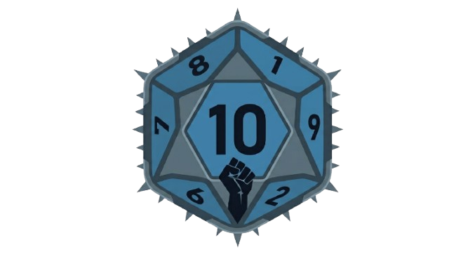

<p align="center">
  
</p>

<h1 align="center">NuMetal Tenzies</h1>

<p align="center">
  The classic Tenzies dice game, played with nu metal album covers instead of numbers.
</p>

---

## About

NuMetal Tenzies is a multiplayer, race-against-the-clock take on Tenzies. Each die shows one of ten nu metal album covers. Roll the dice, hold the covers you want to keep, and keep rolling until all ten dice show the same album. The faster you finish, the higher you rank.

## How to Play

1. Add one or more players on the start screen.
2. Each player takes a turn. Press Ready to start your run.
3. Click a die to hold it. Click it again to release it.
4. Press Roll to re-roll every die that is not held.
5. When all ten dice are held and show the same album cover, your timer stops.
6. After every player has had a turn, the leaderboard ranks everyone by time in milliseconds. The fastest player is first.

## Features

- Multiple players per session
- Millisecond-precision timer that starts when your turn begins and stops when you win
- Leaderboard sorted by fastest time
- Confetti on the results screen
- Responsive layout with a dark theme

## Built With

- React 19
- Vite
- nanoid for unique die and player IDs
- react-confetti and react-use for the results screen
- oxlint for linting

## Play Online

Try the game here: [Play NuMetal Tenzies](https://nu-me-tal-tenzies.netlify.app/)

## Getting Started

### Prerequisites

- Node.js 18 or newer
- npm

## Project Structure

```
src/
  App.jsx        Switches between the players, game, and results screens
  Players.jsx    Add and remove players
  Player.jsx     A single player entry
  Main.jsx       Turn flow: ready, play, and finish
  Game.jsx       Dice logic and the millisecond timer
  Die.jsx        A single die showing an album cover
  Results.jsx    Leaderboard and confetti
  Header.jsx     Logo and title bar
  assets/        Logo, icons, and album cover images
```

## Disclaimer

This is a fan-made, non-commercial project. All album artwork belongs to its respective artists, labels, and copyright holders. It is used here for a personal, educational and fun game only and is not affiliated with or endorsed by any of them.

## Author

Created by [Yasseen-Drei](https://github.com/Yasseen-Drei).